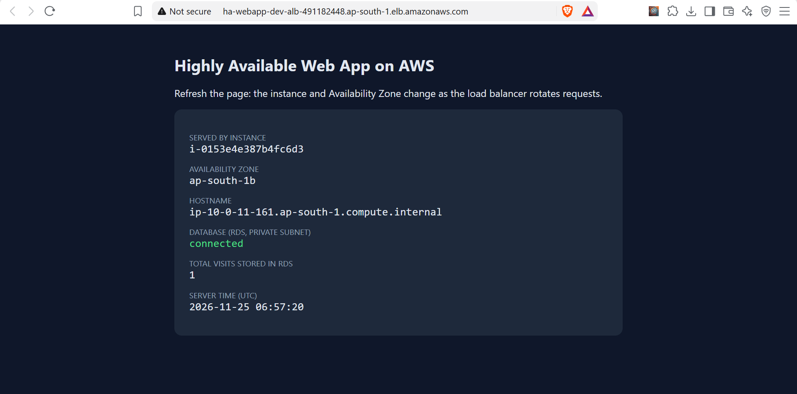
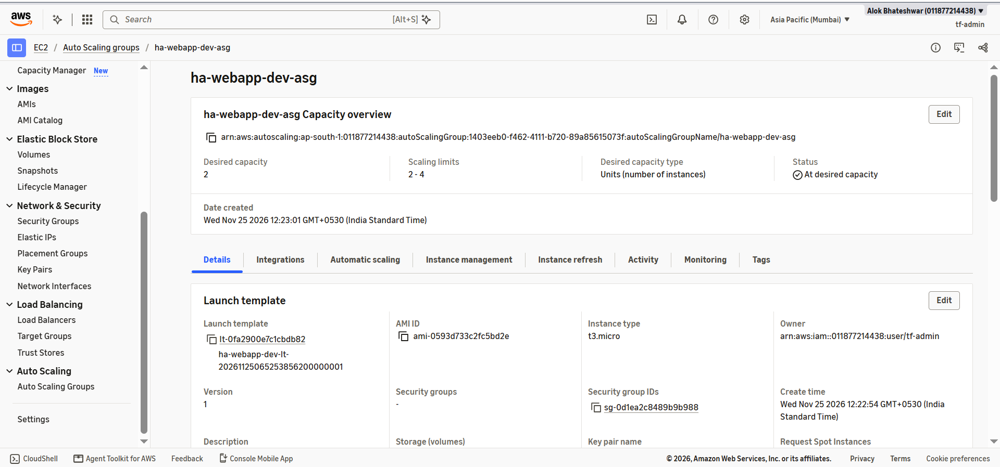

# Highly Available & Scalable Web Application on AWS (Terraform)

A production-style **3-tier architecture** on AWS, built entirely with Terraform:
multi-AZ VPC, Application Load Balancer, Auto Scaling EC2 fleet, private RDS MySQL,
S3, CloudWatch monitoring and SNS alerts. Optional Route 53 domain + HTTPS.

> Resume line: *Designed and deployed a scalable web application on AWS using EC2, Auto Scaling, Load Balancer, and RDS with secure VPC networking and monitoring via CloudWatch.*

## Features

- **High availability**: resources span 2 AZs, unhealthy instances are replaced automatically
- **Scalability**: CPU target-tracking Auto Scaling (2 to 4 instances by default)
- **Security**: public/private/DB subnet tiers, security-group chaining, IAM roles, no SSH (SSM Session Manager), IMDSv2, encrypted storage, DB password in Secrets Manager
- **Monitoring**: CloudWatch dashboard, 6 alarms, application logs and memory/disk metrics, SNS email alerts
- **Infrastructure as Code**: reusable modules, input validation, GitHub Actions CI (fmt, validate, Checkov)

## Architecture

See   for the full diagram and design decisions.

```
User -> Route 53 -> ALB (public subnets) -> EC2 Auto Scaling Group (private subnets) -> RDS MySQL (private DB subnets)
                                                    |-> S3 (via VPC endpoint)    |-> CloudWatch -> SNS -> Email
```

## Project structure

```
aws-ha-webapp/
├── README.md
├── app/
│   ├── app.py                  # Flask demo app (shows instance/AZ, uses RDS + S3)
│   └── requirements.txt
├── terraform/
│   ├── main.tf                 # wires all modules together
│   ├── variables.tf
│   ├── outputs.tf
│   ├── providers.tf
│   ├── versions.tf
│   ├── terraform.tfvars.example
│   ├── backend.tf.example      # optional S3 remote state
│   └── modules/
│       ├── vpc/                # VPC, subnets, IGW, NAT, route tables, S3 endpoint
│       ├── security/           # ALB / App / DB security groups
│       ├── alb/                # load balancer, target group, listeners
│       ├── compute/            # IAM role, launch template, ASG, scaling policy, user data
│       ├── rds/                # MySQL in private subnets, managed secret
│       ├── s3/                 # encrypted, private, versioned bucket
│       ├── acm/                # TLS certificate (optional)
│       ├── route53/            # alias record (optional)
│       └── monitoring/         # SNS, alarms, dashboard
├── scripts/
│   └── load_test.sh            # triggers Auto Scaling for demo
├── docs/
│   ├── architecture.md
│   └── screenshots/            # put your deployment screenshots here
└── .github/workflows/
    └── terraform-ci.yml
```

## Prerequisites

- An AWS account and an IAM user/role with permissions to create the resources above
- [Terraform](https://developer.hashicorp.com/terraform/install) >= 1.5
- [AWS CLI](https://docs.aws.amazon.com/cli/latest/userguide/install-cliv2.html) configured: `aws configure`
- (Optional) a Route 53 public hosted zone if you want a custom domain

## Deploy

```bash
git clone https://github.com/<your-username>/aws-ha-webapp.git
cd aws-ha-webapp/terraform

cp terraform.tfvars.example terraform.tfvars
# edit terraform.tfvars -> set alert_email (required) and anything else you want

terraform init
terraform plan
terraform apply
```

Apply takes about 10-15 minutes (RDS is the slowest part). When finished, Terraform prints `app_url`.

1. Open an email from AWS SNS and click **Confirm subscription** (otherwise you get no alerts).
2. Wait 3-5 minutes after apply for instances to bootstrap, then open `app_url`.
3. Refresh several times: the **instance ID and AZ change**, and the **visit counter** increases (stored in RDS).

### Custom domain + HTTPS (optional)

In `terraform.tfvars`:

```hcl
domain_name      = "app.example.com"
hosted_zone_name = "example.com"
```

Terraform will create the ACM certificate (DNS-validated), HTTPS listener, HTTP to HTTPS redirect and the Route 53 alias record.

## Test the features

| Feature | How to test |
|---------|-------------|
| Load balancing | Refresh the app page; `Served by instance` alternates |
| Health endpoint | `curl <app_url>/health` returns `ok` |
| Database | `curl <app_url>/db` returns the visit count |
| S3 + IAM role | `curl <app_url>/s3` writes an object to the bucket |
| **High availability** | EC2 console: terminate one instance. The site stays up and the ASG launches a replacement |
| **Auto Scaling** | `./scripts/load_test.sh <app_url> 40 600`, then watch EC2 > Auto Scaling Groups > Activity |
| Alarms + SNS | CloudWatch > Alarms, and check your inbox |
| Shell access (no SSH) | EC2 > select instance > Connect > Session Manager |

## Clean up (important, avoids charges)

```bash
cd terraform
terraform destroy
```

The NAT Gateway, ALB and RDS cost money while running. Always destroy when you are done.

## Screenshots

Follow the checklist in [docs/screenshots/README.md](docs/screenshots/README.md), then embed them here:

```markdown


```

## Production hardening ideas

Set `db_multi_az = true`, `single_nat_gateway = false`, `db_deletion_protection = true`, `db_skip_final_snapshot = false`, use a remote S3 backend (`backend.tf.example`), and add AWS WAF and CloudFront.

## Tech stack

Terraform, AWS (VPC, EC2, ALB, Auto Scaling, RDS, S3, CloudWatch, SNS, IAM, Route 53, ACM, Secrets Manager, SSM), Python/Flask, GitHub Actions.
