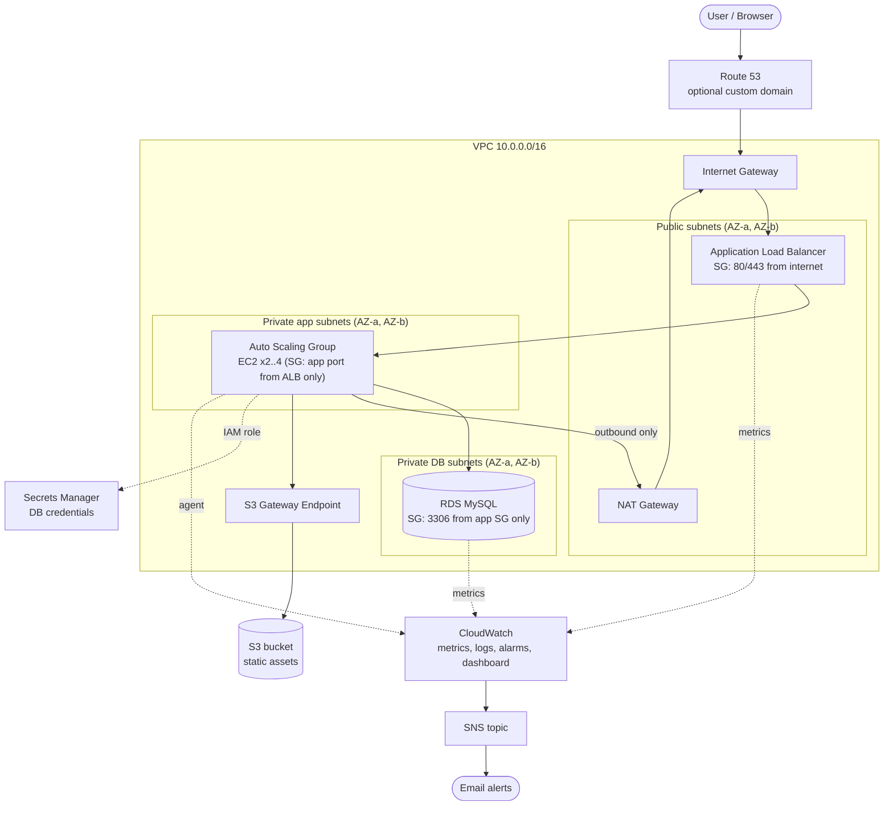

# Architecture

## Diagram

GitHub renders this Mermaid diagram automatically.

## Request flow

1. User opens the domain (or the ALB DNS name).
2. Route 53 resolves it to the Application Load Balancer (alias record).
3. The ALB, in the public subnets, accepts the request and picks a healthy target.
4. The request is forwarded to an EC2 instance in a private subnet.
5. The app reads/writes MySQL on RDS (private DB subnet) using credentials fetched from Secrets Manager.
6. The response travels back through the ALB to the user.

## Design decisions

| Goal | How it is achieved |
|------|--------------------|
| **High availability** | ALB and ASG span 2 AZs. ASG health check type is `ELB`, so unhealthy instances are replaced automatically. RDS supports Multi-AZ (`db_multi_az = true`). |
| **Scalability** | Target-tracking policy keeps average CPU near 50%. ASG scales between `asg_min_size` and `asg_max_size`. RDS storage autoscaling is enabled. |
| **Network isolation** | Three subnet tiers. Only the ALB is internet-facing. App servers have outbound-only access via NAT. DB subnets have no internet route at all. |
| **Access control** | Security groups chain ALB -> App -> DB using SG references, not CIDRs. No SSH: shell access via SSM Session Manager. IMDSv2 enforced. |
| **Secrets** | RDS generates the master password and stores it in Secrets Manager (`manage_master_user_password`). Nothing sensitive is in Terraform code or git. |
| **IAM** | EC2 role can read one secret and use one bucket, plus the managed SSM and CloudWatch agent policies. |
| **Encryption** | EBS volumes, RDS storage and S3 are encrypted at rest. S3 denies non-TLS requests. HTTPS + HTTP->HTTPS redirect when a domain is configured. |
| **Monitoring** | CloudWatch dashboard, 6 alarms (CPU, 5xx, unhealthy hosts, latency, RDS CPU, RDS storage), app logs shipped by the CloudWatch agent. |
| **Alerting** | Alarms and ASG scaling events publish to an SNS topic with an email subscription. |

## Subnet layout (default `10.0.0.0/16`, 2 AZs)

| Tier | AZ-a | AZ-b |
|------|------|------|
| Public (ALB, NAT) | 10.0.0.0/24 | 10.0.1.0/24 |
| Private app (EC2) | 10.0.10.0/24 | 10.0.11.0/24 |
| Private DB (RDS) | 10.0.20.0/24 | 10.0.21.0/24 |

## Cost notes (lab vs production)

* The **NAT Gateway** and the **ALB** are the main hourly costs; RDS and EC2 `t3.micro` are small.
* `single_nat_gateway = true` is cheapest but is a single point of failure for outbound traffic. Use `false` in production.
* `db_multi_az = true` doubles RDS cost but gives automatic failover.
* Always run `terraform destroy` when you finish a lab session.

## Possible extensions

* AWS WAF on the ALB
* CloudFront in front of the ALB / S3
* CI/CD with CodeDeploy or GitHub Actions plus a baked AMI
* RDS read replica, ElastiCache
* VPC Flow Logs and AWS Config rules
